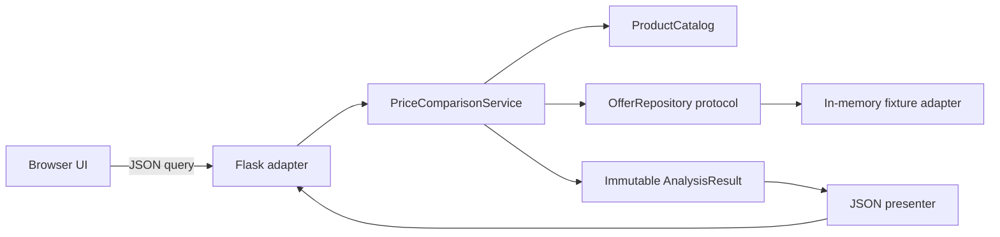

# PriceLens

[](https://github.com/sahildcodes/pricelens/actions/workflows/ci.yml)

PriceLens is a compact product-comparison prototype built with Flask and browser-native JavaScript. It demonstrates how I structure a web system around explicit domain boundaries, deterministic behavior, testable dependencies, privacy-conscious defaults, and honest product constraints.

> **Scope:** This repository is an engineering prototype. Product matches, prices, stock, distances, and recommendations are fixtures—not live merchant data. The optional image is previewed locally in the browser and is never uploaded or analyzed.

## Engineering highlights

- **Functional core, imperative shell:** matching and comparison are framework-independent; Flask is a thin transport adapter.
- **Immutable domain model:** frozen dataclasses prevent request-specific state from leaking across requests.
- **Exact monetary arithmetic:** prices use integer cents internally, avoiding floating-point rounding errors.
- **Dependency inversion:** the service depends on an `OfferRepository` protocol, so fixtures can be replaced by merchant/API adapters without changing business logic.
- **Deterministic ranking:** keyword overlap produces reproducible results with stable tie-breaking.
- **Versioned API:** the browser calls `/api/v1/analyze`, with structured error codes and a documented contract.
- **Privacy by design:** selected photos remain client-side; only a bounded text query reaches the server.
- **Defense in depth:** request limits, secure defaults, CSP and related headers, JSON validation, no-store API responses, and no debug mode by default.
- **Layered tests:** unit tests cover tokenization, ranking, invariants, money conversion, and repository failures; integration tests cover HTTP behavior and headers.

## Architecture



The web layer validates transport concerns, the service owns the use case, and the domain layer enforces invariants. See [docs/architecture.md](docs/architecture.md) for design rationale, complexity, failure behavior, and a production evolution path.

## Matching algorithm

The catalog normalizes the query into unique lowercase alphanumeric tokens. Each product is scored by set intersection with its keyword set. The highest positive score wins; catalog order is the deterministic tie-breaker.

For `P` products, `Q` unique query tokens, and at most `K` keywords per product:

- Tokenization: `O(|query|)`
- Ranking: `O(P × min(Q, K))` average-case set operations
- Offer partitioning and minimum selection: `O(O)`, where `O` is the number of offers
- Additional working memory: `O(Q + O)`

This deliberately simple algorithm is appropriate for a tiny fixture catalog. A larger system would replace the catalog adapter with indexed retrieval or embedding search while preserving the service boundary.

## Project structure

```text
app.py                    Local development entry point
pricelens/
  __init__.py             Application factory and security policy
  domain.py               Immutable entities and invariants
  catalog.py              Tokenization and deterministic matching
  repository.py           OfferRepository port and fixture adapter
  service.py              Comparison use case
  presenter.py            Domain-to-JSON boundary
  data.py                 Explicit demo fixtures and dependency wiring
templates/index.html      Accessible UI structure
static/                   Browser behavior and responsive styling
tests/                    Unit and HTTP integration tests
docs/architecture.md      Design rationale and evolution path
```

## Run locally

Python 3.12 or newer is recommended.

```bash
python3 -m venv .venv
source .venv/bin/activate
python -m pip install --upgrade pip
python -m pip install -r requirements.txt
python app.py
```

Open <http://127.0.0.1:5000>. Optional local variables are documented in `.env.example`; the application does not automatically load that file.

## API contract

### `POST /api/v1/analyze`

```json
{
  "query": "road running shoe"
}
```

Successful responses identify their version and fixture source:

```json
{
  "meta": {
    "api_version": "1",
    "data_source": "fixtures"
  },
  "demo": {
    "enabled": true
  },
  "product": {},
  "results": {},
  "recommendation": {}
}
```

Errors have a stable machine-readable shape:

```json
{
  "error": {
    "code": "no_match",
    "message": "No sample match..."
  }
}
```

The query is required, must be a string, and is limited to 200 characters. The mock catalog recognizes bike/cycling and running-shoe vocabulary. `GET /health` provides a minimal liveness endpoint.

## Tests and continuous integration

```bash
python -m unittest discover -s tests -v
```

GitHub Actions runs the full suite on Python 3.12 and 3.13 for every push and pull request. Dependabot checks both Python and GitHub Actions dependencies weekly.

## Security and privacy

- Images use browser object URLs and never cross the network boundary.
- API requests are JSON-only, capped at 64 KiB, and never cached.
- Dynamic UI strings use `textContent` rather than HTML interpolation.
- External links are fixed fixture data and open with `noopener`.
- Flask debug mode and non-loopback binding are opt-in, never defaults.
- The repository excludes environments, secrets, caches, and OS metadata.

Production deployment would additionally require a production WSGI server, TLS termination, platform-level rate limiting, structured telemetry, secret management, and live data-provider controls.

## Intentional tradeoffs

- **No fake AI:** the repository does not claim computer vision or live search that it does not implement.
- **No premature database:** immutable fixtures keep the current data boundary obvious; the repository protocol marks the replacement point.
- **No microservices:** one process is the correct operational shape for this scope.
- **No frontend framework:** the interaction is small enough for accessible, dependency-free JavaScript.

## License

PriceLens is source-available under the PolyForm Noncommercial License 1.0.0. You may use, modify, and share it for permitted noncommercial purposes. Commercial use requires separate permission from the copyright holder. See [LICENSE](LICENSE) for the controlling terms.

Merchant and product names belong to their respective owners. Their appearance in fixture data does not imply affiliation or endorsement.
